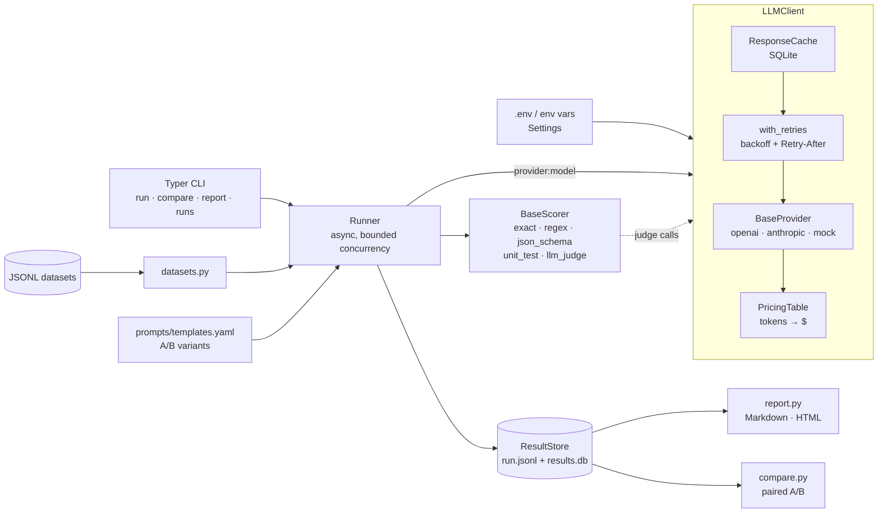

# llm-eval-framework

A benchmark and prompt-evaluation framework for comparing LLM outputs. It runs a JSONL
dataset through any mix of **models x prompt templates** and scores the outputs with
pluggable scorers: exact match, regex, JSON schema, unit tests executed in a subprocess,
and an LLM judge. Results go to JSONL and SQLite, and the framework produces Markdown and
HTML reports plus paired A/B comparisons.

- **Providers:** OpenAI, Anthropic, and an offline `mock` provider for tests and dry runs
- **Reliability:** retries with exponential backoff and jitter, honoring `Retry-After` on rate limits
- **Cost control:** per-call token and cost tracking, plus a SQLite response cache, so re-runs are free
- **A/B testing:** compare templates, models, or whole runs, with win/loss counts and a sign test

## Architecture



| Module | Responsibility |
|---|---|
| `models.py` | Pydantic models: `Example`, `PromptTemplate`, `GenerationRequest`, `ModelResponse`, `Usage`, `ScoreResult`, `RunRecord` |
| `config.py` | `Settings` from env vars / `.env` |
| `datasets.py` | JSONL loading, validation, tag filtering |
| `prompts.py` | Template loading and rendering |
| `providers/` | `BaseProvider` + registry; `openai`, `anthropic`, `mock` |
| `reliability.py` | `RetryPolicy`, `with_retries` |
| `cache.py` | SQLite response cache |
| `pricing.py` | Default $/1M-token prices + override file |
| `client.py` | `LLMClient`: spec → provider, cache, retries, usage stats |
| `scorers/` | `BaseScorer` + registry and the five built-in scorers |
| `runner.py` | Orchestrates generate → score → store |
| `storage.py` | JSONL + SQLite persistence |
| `report.py` / `compare.py` | Aggregation, Markdown/HTML reports, A/B comparison |
| `cli.py` | `llm-eval` command |

## Quickstart

Requires Python 3.12.

```bash
git clone <repo-url> llm-eval-framework && cd llm-eval-framework
python -m venv .venv
source .venv/bin/activate          # Windows: .venv\Scripts\activate
pip install -e ".[dev]"

# 1. Offline dry run with the mock provider: no keys, no cost
llm-eval run -d reasoning -m mock:echo -s exact,regex

# 2. Real models: put your keys in .env (see .env.example)
cp .env.example .env               # then fill in OPENAI_API_KEY / ANTHROPIC_API_KEY

llm-eval run -d reasoning \
  -m openai:gpt-4o-mini,anthropic:claude-opus-5-5 \
  -s exact,regex \
  -t baseline,expert

# 3. Reports and comparisons (default: latest run)
llm-eval report                     # writes results/reports/<run_id>.md and .html
llm-eval compare --by template --a baseline --b expert
llm-eval compare --by model --a openai:gpt-4o-mini --b anthropic:claude-opus-5-5
llm-eval runs                       # list recent runs
```

Coding set with unit tests and an LLM judge:

```bash
llm-eval run -d coding -m anthropic:claude-opus-5-5 -s unit_test,json_schema,llm_judge
```

> **Cost note:** `llm_judge` makes one extra model call per output, using the judge
> model (`LLM_EVAL_JUDGE_MODEL`, default `anthropic:claude-opus-5-5`). Use `--limit 3`
> for a cheap first pass. Cached calls are free on re-runs.

## CLI reference

| Command | Key options |
|---|---|
| `llm-eval run` | `-d/--dataset` (path or name in `datasets/`), `-m/--models` (`provider:model`, comma-separated or repeated), `-s/--scorers` (default `exact`), `-t/--templates` (default `baseline`), `--templates-file`, `--tags`, `--limit`, `--concurrency`, `--no-cache`, `--max-tokens`, `--temperature`, `--judge-model`, `--notes`, `--results-dir` |
| `llm-eval compare` | `--by template\|model\|run`, `--a`, `--b` (auto-picked when exactly two exist), `-r/--run` (run ids; `--by run` defaults to the two latest), `-o/--output` |
| `llm-eval report` | `-r/--run` (one or more; default latest), `-f/--format md\|html\|both`, `--output-dir` |
| `llm-eval runs` | `--limit` |

Progress output: `.` = call made, `c` = cache hit, `E` = generation error.

## Datasets

One JSON object per line:

```json
{"id": "bat-ball", "prompt": "A bat and a ball cost ...", "expected": "5",
 "tags": ["reasoning", "math"], "scorer_args": {"regex": {"pattern": "(?i)answer:\\s*5\\b"}}}
```

| Field | Required | Notes |
|---|---|---|
| `prompt` | yes | Inserted into templates as `{prompt}` |
| `id` | no | Defaults to `<file>-<line>`; must be unique |
| `expected` | no | Reference answer (string or list of acceptable strings) for `exact`; shown to the judge |
| `tags` | no | Used for `--tags` filtering and per-tag report breakdowns |
| `scorer_args` | no | Per-scorer configuration keyed by scorer name |

Sample sets:

- `datasets/coding.jsonl` has 6 Python tasks (unit tests), 3 SQL tasks (expected rows in SQLite) and 1 JSON-schema task.
- `datasets/reasoning.jsonl` has 10 logic and math items. Each asks for a final `Answer: <x>` line, which is scored with `exact` and `regex`.

## Scorers

Every scorer returns a score in **[0, 1]**. A scorer is skipped for an example that lacks
the `scorer_args` it needs, so one run can mix item types.

| Name | Needs | Behavior |
|---|---|---|
| `exact` | `expected` | Normalized comparison (case, whitespace, trailing period, markdown). Uses the last `Answer:` line if present. Options: `case_sensitive`, `extract_answer`. |
| `regex` | `scorer_args.regex.pattern` | `re.search`; options `ignore_case`, `negate`. |
| `json_schema` | `scorer_args.json_schema.schema` | Pulls JSON from a fenced block or the text and validates it (Draft 2020-12). |
| `unit_test` | `scorer_args.unit_test` | **Python:** `tests` is a list of statements run against the extracted code; score = fraction passed. **SQL:** runs the query on SQLite after `setup` and compares to `expected_rows` (`ordered` optional). Subprocess with `timeout` (default 10s). |
| `llm_judge` | — | Rubric scores for **correctness, clarity and safety**, each 1–5, returned as JSON. Overall = (mean − 1) / 4. The judge model comes from `scorer_args.llm_judge.model` or `LLM_EVAL_JUDGE_MODEL`; `criteria` adds extra guidance. |

When a scorer itself fails (for example an invalid pattern or a judge reply that isn't
JSON), the failure is stored in `ScoreResult.error` and **excluded from averages**
instead of being counted as 0.

> ⚠️ **`unit_test` is not a security sandbox.** It runs model-generated code in a separate
> `python -I` process in a temp directory with a timeout, which handles hangs and crashes
> but **not** malicious code. Run untrusted models' code inside a container or VM.

## Prompt templates (A/B)

`prompts/templates.yaml` defines named variants:

```yaml
expert:
  system: "You are a senior software engineer ..."
  template: |-
    Task:
    {prompt}

    Before finalizing, verify your answer against the task requirements.
```

Placeholders are `{prompt}`, `{id}` and `{tags}`; other braces are left as-is. Run
several variants with `-t baseline,concise,expert`, then compare them:

```bash
llm-eval compare --by template --a baseline --b expert
```

The comparison pairs results by (example, model) and reports both means, the delta,
B's win/loss/tie counts, a two-sided exact **sign-test p-value**, and per-tag deltas.

## Results

```
results/
  results.db               # SQLite: runs, results, scores tables
  <run_id>.jsonl           # one RunRecord per line
  reports/<run_id>.md|html
```

You can also query the database directly:

```sql
SELECT r.model, r.template, s.scorer, AVG(s.score) AS mean, COUNT(*) AS n
FROM scores s JOIN results r ON r.id = s.result_id
WHERE s.run_id = '20261107-101500-ab12cd' AND s.error IS NULL
GROUP BY 1, 2, 3;
```

## Configuration

Settings come from environment variables or `.env` (see `.env.example`):

| Variable | Default | |
|---|---|---|
| `OPENAI_API_KEY`, `ANTHROPIC_API_KEY` | — | Provider credentials (Anthropic also accepts other SDK-resolved credentials) |
| `LLM_EVAL_RESULTS_DIR` | `results` | |
| `LLM_EVAL_CACHE_PATH` | `.llm_eval_cache/cache.db` | Delete it to clear the cache |
| `LLM_EVAL_CONCURRENCY` | `4` | Parallel requests |
| `LLM_EVAL_MAX_RETRIES` | `4` | Retries for 429 / 5xx / timeouts / connection errors |
| `LLM_EVAL_RETRY_BASE_DELAY` / `LLM_EVAL_RETRY_MAX_DELAY` | `1` / `60` s | Backoff: `base * 2^attempt` with jitter; `Retry-After` wins, capped at the max |
| `LLM_EVAL_REQUEST_TIMEOUT` | `120` s | |
| `LLM_EVAL_PRICING_FILE` | — | JSON/YAML price overrides |
| `LLM_EVAL_JUDGE_MODEL` | `anthropic:claude-opus-5-5` | |

**Pricing.** `pricing.py` ships default USD-per-1M-token prices for common Anthropic and
OpenAI models. Prices change, so check them and override or extend them with a file:

```yaml
# pricing.yaml  ->  LLM_EVAL_PRICING_FILE=pricing.yaml
gpt-4o-mini: {input: 0.15, output: 0.60}
my-finetune: {input: 1.00, output: 2.00}
```

Models with no known price report cost as `n/a`; tokens are still tracked.

**Caching.** Responses are keyed by provider, model, prompt, system prompt, `max_tokens`
and temperature. Cache hits cost $0 and show as `Cached` in reports. Use `--no-cache` to
force fresh calls, for example to measure run-to-run variance.

**Provider notes.**
- *Anthropic:* sampling parameters aren't sent, because current Claude models reject them. A refusal is recorded as the output `[refusal]`. Server-side model fallbacks are deliberately **off**, so a benchmark always measures the model it names.
- *Both:* SDK-level retries are disabled so that our retry policy is the only one in effect.

## Extending

### Add a provider

```python
# src/llm_eval/providers/my_provider.py
from llm_eval.models import GenerationRequest
from llm_eval.providers.base import (
    BaseProvider,
    Completion,
    ProviderError,
    RateLimitError,
    TransientError,
    register_provider,
)


@register_provider
class MyProvider(BaseProvider):
    name = "myprov"  # used as `myprov:<model>` on the CLI

    async def _complete(self, request: GenerationRequest) -> Completion:
        try:
            text, n_in, n_out = await call_my_api(
                request.model, request.prompt, request.system, request.max_tokens
            )
        except MyRateLimit as e:  # map backend errors so retries work:
            raise RateLimitError(str(e), retry_after=e.retry_after) from e  # 429
        except MyServerError as e:
            raise TransientError(str(e)) from e  # retryable
        except MyClientError as e:
            raise ProviderError(str(e)) from e  # fatal
        return Completion(text=text, input_tokens=n_in, output_tokens=n_out)
```

Then add the module to the import in `providers/base.py::_ensure_builtin_providers` (or
import it anywhere before use), and add prices to `pricing.py` or your pricing file.
Settings and pricing are available as `self.settings` and `self.pricing`; override
`aclose()` if you hold a client. Test it offline by injecting a fake client, as
`tests/test_real_providers.py` does.

### Add a scorer

```python
# src/llm_eval/scorers/length.py
from llm_eval.models import Example, ScoreResult
from llm_eval.scorers.base import BaseScorer, ScoringContext, register_scorer


@register_scorer
class MaxLengthScorer(BaseScorer):
    name = "max_length"  # used with `-s max_length`

    def applicable(self, example: Example) -> bool:
        return "max_chars" in self.args(example)  # reads scorer_args.max_length

    async def score(self, example: Example, output: str, ctx: ScoringContext) -> ScoreResult:
        limit = self.args(example)["max_chars"]
        ok = len(output) <= limit
        return self.result(1.0 if ok else 0.0, ok, length=len(output), limit=limit)
```

Register it by adding the module to `scorers/base.py::_ensure_builtin_scorers`. Scorers
that need a model call use `ctx.client.generate(spec, prompt, ...)`, which goes through
the same cache, retries and cost tracking (see `llm_judge.py`).

## Development

```bash
pip install -e ".[dev]"
pytest                 # offline; uses the mock provider and fake SDK clients
ruff check . && ruff format --check .
```

CI (`.github/workflows/ci.yml`) runs ruff, plus pytest on Ubuntu and Windows.
See [CHANGELOG.md](CHANGELOG.md) for history.

## License

Released under the [MIT License](LICENSE). Copyright (c) 2026 Shahid Ul Islam.
